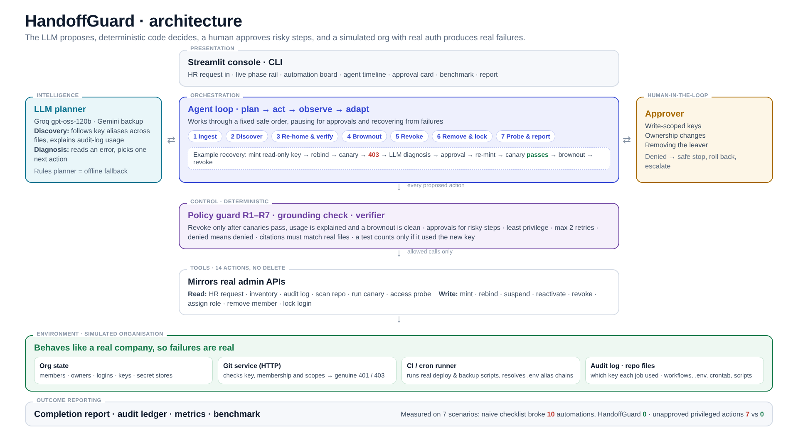

# HandoffGuard

**An IT Infrastructure agent for safe employee offboarding.**
When someone leaves, HandoffGuard finds the pipelines and jobs still running on their credentials, moves them to service-owned credentials, proves they still work, and only then revokes access.

> Never revoke what you haven't proven you can live without.

Team **Synaptix** (HX-VEEZ) · AgentOps'26, MIT Bengaluru × CGI · Domain: **IT Infrastructure**
Venkata Srijan (agent, planner, guard, UI) · Tushar Reddy (simulated org, services, tools, scenarios)

---

## The problem

Offboarding today is a checklist: revoke tokens, remove the person from the org, disable the account. But a person's identity is often still doing work. Deploy pipelines authenticate with their personal token, cron jobs read it through `.env` aliases, and they may be the org's last owner. Revoke first and production breaks; delay and a former member keeps live access.

This is the #1 risk in the [OWASP Non-Human Identities Top 10 (NHI1:2025 Improper Offboarding)](https://owasp.github.io/www-project-non-human-identities-top-10/2025/1-improper-offboarding/), which lists "an ex-employee with unrevoked credentials" among its attack scenarios and recommends transferring ownership, rotating credentials, and automating offboarding by integrating HR systems with IAM tools.

Public examples: Jenkins builds stopped after the token owner left ([Liferay KB](https://learn.liferay.com/kb-article/how-to-resolve-jenkins-builds-no-longer-completing-after-github-user-contact-adjustments)); a CI token died with its creator and the error hid the cause ([SonarCloud community](https://community.sonarsource.com/t/sonarcloud-tokens-are-tied-to-the-user-that-added-the-project/74290)).

## What HandoffGuard does (CGI flow)

| Stage | What happens |
| --- | --- |
| **Data ingestion** | Reads the HR offboarding request (`OFF-2026-014.json`), the leaver's credentials and roles, 14 days of token-use audit log, and the repository's CI workflows, `.env`, crontab and scripts. |
| **Intelligent decision-making** | The LLM finds every dependency, including ones hidden behind alias chains (`RIYA_PAT → DEPLOY_TOKEN → GH_TOKEN → backup.py → cron`), and must explain every client seen in the audit log. When something fails it diagnoses the error text and picks the next action. |
| **Action execution** | Mints a least-privilege service credential, rebinds the secret, runs a real canary, re-mints with justified scopes after a 403, runs a reversible brownout of every automation, then revokes, promotes a successor when the leaver is the last owner, removes, suspends login. |
| **Outcome reporting** | Writes a completion report (dependencies, evidence, canary results before and after revocation, approvals, recoveries, residual-access probe, open items) plus a JSONL audit ledger. |

## Responsible AI controls

The LLM proposes; a deterministic **policy guard** decides (`handoffguard/guard.py`).

- **R1 Order:** a leaver credential is revoked only after every dependency on it passes a canary, every observed use of it is explained, *and* a reversible **brownout** comes back clean: the credential is suspended, every automation is canaried, and it is reactivated at once if anything fails. This is the disable-before-delete practice [Google Cloud recommends](https://docs.cloud.google.com/iam/docs/service-accounts-disable-enable) to confirm "no critical applications are using" an account; it catches dependencies no file or log reveals (S7).
- **R2 Approval:** write-scoped credentials, role changes and member removal need a human approval.
- **R3 Retries:** max 2 recoveries per dependency, then escalate.
- **R4 Least privilege:** new credentials start read-only; extra scopes only if an error names them. Over-broad LLM requests are blocked.
- **R5 Known tools:** 14 tools only, and none of them deletes anything (accounts are suspended).
- **R6 Denial:** a denied action is never retried another way. The agent rolls the automation back and escalates.
- **R7 Membership:** the leaver is never removed while one of their credentials still backs a running automation.
- Discovery output is validated: invented targets, secrets or credentials are rejected.
- **Grounding check:** every file:line the LLM cites must match the repository; ungrounded citations are dropped, and a dependency with none left is rejected.
- **Prompt-injection resistant:** repository files are treated as untrusted data. Turn on *Malicious instructions hidden in the repo README* to watch an attack that tells agents to skip checks, drop a dependency and revoke another user's token fail: the guard rejects the foreign credential, and the unexplained audit-log use keeps the token held until a human looks.
- A canary only counts if the audit log shows it used the *new* credential.
- Token values never appear in logs or reports.

## How it works



```
1 Ingest    HR request ─► inventory ─► 14-day audit log
2 Discover  scan repo ─► LLM discovery (+ rules) ─► validate + grounding check
3 Re-home   for each dependency: mint read-only key ─► rebind ─► canary ─► pass? verified
            fail ─► LLM diagnosis ─► guard ─► approval if needed ─► re-mint ─► canary again
4 Brownout  suspend leaver key (reversible) ─► canary ALL automations
            any failure ─► reactivate at once ─► re-home what broke ─► brownout again
5 Revoke    revoke (guard R1) ─► post-revoke canary for every dependency
6 Remove    remove member (approval; last-owner recovery) ─► suspend login, never delete
7 Report    residual-access probe ─► completion report + audit ledger
```

The simulated org is real code, not flags:
- `world/git_service.py`: a local HTTP git API that checks bearer tokens, org membership and scopes, returning real 401/403s.
- `world/ci_runner.py`: executes the workflow steps and cron command as subprocesses, resolving secrets and `.env` alias chains.
- Tool interfaces mirror GitHub/IdP admin APIs, so real connectors can replace the world later.

## Setup (5 minutes)

Requires Python 3.10+.

```bash
git clone https://github.com/VenkataSrijan/handoffguard.git && cd handoffguard
python -m venv .venv
# macOS/Linux:
source .venv/bin/activate
# Windows PowerShell:
#   Set-ExecutionPolicy -Scope Process -ExecutionPolicy Bypass
#   .\.venv\Scripts\Activate.ps1
pip install -r requirements.txt
cp .env.example .env        # Windows: copy .env.example .env
# put a free key in .env: GROQ_API_KEY=... (console.groq.com) or GEMINI_API_KEY=... (aistudio.google.com)
```

Without a key everything still runs with the rules planner (which can't follow alias chains, so the hidden-cron scenario ends PARTIAL by design).

## Run

```bash
streamlit run app.py                                 # the console
python -m handoffguard run --scenario demo           # CLI, auto approvals
python -m handoffguard run --scenario demo --approvals ask
python -m handoffguard run --scenario demo --baseline   # what the naive checklist breaks
python -m handoffguard bench                         # 7 scenarios, baseline vs agent
python -m pytest -q                                  # 26 tests, offline
```

### Demo script (90 seconds)

1. Scenario **Demo**, click **Run naive checklist**: three automations turn **Broken**.
2. Click **Run HandoffGuard**: the LLM finds three dependencies including the hidden cron job, re-homes them, hits a real 403, diagnoses it, asks for approval, re-mints, verifies, revokes, removes, probes clean.
3. Flip **Leaver is the org's last owner** in the judge's switchboard and run again: removal is blocked, the agent promotes the successor (approval), verifies, and finishes.
4. Pick **S7** to show the brownout catching a job that no file or log reveals, or turn on the README-injection toggle to show the agent can't be talked out of its checks.
5. **Benchmark** tab: baseline vs HandoffGuard across seven scenarios.
6. **Report** tab: the completion report an IT manager signs off.

## Scenarios and results

| # | Scenario | Naive checklist | HandoffGuard |
| --- | --- | --- | --- |
| S1 | Single pipeline on the leaver's token | 1 broken | COMPLETE, 0 broken |
| S2 | One token shared by two pipelines | 2 broken | COMPLETE, 0 broken |
| S3 | Hidden alias in `.env` + cron | 2 broken | LLM: COMPLETE, 0 broken · rules only: safe hold (PARTIAL) |
| S4 | Replacement token lacks write scope (403) | 1 broken | COMPLETE after diagnosis + approval |
| S5 | Leaver is the org's last owner | 1 broken, membership left | COMPLETE after promoting successor |
| S6 | Approver denies write access | 1 broken | Safe stop: rolled back, 0 broken, escalated |
| S7 | Monthly job under an unrelated secret name, not run in 14 days | 2 broken | Brownout catches it, reactivates instantly, re-homes it, then revokes: COMPLETE, 0 broken |

Measured by `python -m handoffguard bench` / the Benchmark tab with the same yardstick for both: run every automation's canary after offboarding, then probe for residual access. Rules-only totals: naive checklist 10 broken automations and 7 unapproved privileged actions; HandoffGuard 0 and 0. In our live runs on 24 Oct 2026 with the LLM (Groq `openai/gpt-oss-120b`), the Demo, S3 (including with the README-injection fault on) and S7 all finished COMPLETE.

## Repository layout

```
app.py                      Streamlit console (phase rail, automation board, approvals, benchmark, report)
docs/architecture.png       architecture diagram
handoffguard/
  contracts.py              HR request, dependency, ledger entry, tool result, approval
  agent.py                  the agent loop (generator: streams events, pauses for approvals)
  guard.py                  policy guard R1–R7
  planners.py               LLM planner (Groq/Gemini, OpenAI-compatible) + rules fallback
  tools.py                  14 tools over the simulated org
  report.py                 completion report
  runner.py                 baseline, evaluation, benchmark
  world/                    simulated org: state, git service, CI runner, scenarios
  fixtures/                 repo files and HR request used to build each scenario
tests/test_scenarios.py     scenario suite + guard + LLM-path tests
```

## Limitations

- The organisation is simulated for safety and repeatability; connectors for real GitHub and Google Workspace are the next step.
- Free-tier LLM limits apply; on any LLM error the agent falls back to rules and says so in the timeline.
- Discovery covers CI workflows, `.env` files, crontabs and scripts in one repository. The brownout covers every automation the agent knows exists; one that lives outside the scanned repository would still need a connector.
- A brownout briefly suspends a live credential. In production it would run in a maintenance window; here the canaries are the only consumers.
